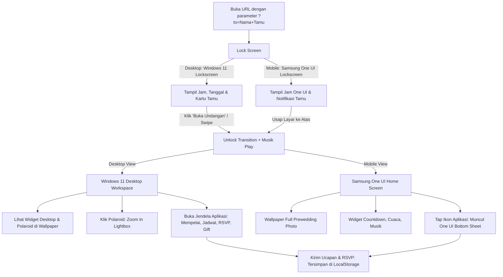

# Spesifikasi Desain: Website Undangan Digital Bertema OS (Windows 11 & Samsung One UI)

**Tanggal:** 2026-10-11  
**Status:** Draf Disetujui (Menunggu Review Akhir)  
**Tipe Proyek:** Frontend Web Application (React + Vite + TypeScript)

---

## 1. Ringkasan Eksekutif & Konsep Utama

Proyek ini adalah pembuatan website **Undangan Pernikahan Digital (*Digital Wedding Invitation*)** dengan konsep unik yang memadukan pengalaman sistem operasi modern:
- **Tampilan Desktop (≥ 1024px)**: Mengadopsi antarmuka **Windows 11** lengkap dengan *Lock Screen Spotlight*, *Centered Taskbar*, jendela aplikasi *Acrylic/Mica* yang dapat digeser (*draggable*), *Desktop Acrylic Widgets* (jam analog, *gauge love meter*, cuaca lokasi, kalender pernikahan, dan *sticky note*), serta dekorasi **Polaroid Interaktif** yang menempel di wallpaper.
- **Tampilan Mobile (< 1024px)**: Mengadopsi antarmuka **Samsung One UI 6.1** dengan wallpaper bersih berupa **Foto Prewedding Mempelai Full-Bleed**, jam Lock Screen One UI, kartu notifikasi penerima undangan, *One UI Squircle Widgets* (Countdown hari H, cuaca, music controller), dan *One UI Bottom Sheet App Modals*.
- **Personalisasi Tamu**: Membaca parameter URL `?to=...` (contoh: `?to=Budi+Santoso` atau `?to=Keluarga+Bpk.+Rahmat`) untuk ditampilkan secara elegan di Lock Screen dan kartu ucapan.
- **Musik Latar**: Otomatis diputar setelah tamu membuka *Lock Screen* (memenuhi aturan *browser user gesture*), dengan kontrol pemutar musik di Taskbar (Desktop) dan Mini Player (Mobile).

---

## 2. Alur Pengguna (User Flow)



---

## 3. Detail Tampilan & Antarmuka Pengguna

### 3.1 Tampilan Desktop (Windows 11 Shell)
1. **Windows 11 Lock Screen**:
   - Background pemandangan/prewedding dengan efek blur halus saat disentuh.
   - Jam & tanggal digital besar di bagian atas.
   - Kartu ucapan selamat datang:
     - Badge judul: *The Wedding of [Pengantin Pria] & [Pengantin Wanita]*
     - Penerima: *"Kepada Yth. Bapak/Ibu/Saudara/i: [Nama Tamu]"*
   - Tombol interaktif dengan efek ripple: *"Buka Undangan"*.

2. **Desktop Workspace & Wallpaper**:
   - **Wallpaper**: Wallpaper romantis bernuansa modern.
   - **Hiasan Polaroid Lucu**: 2–3 frame polaroid fisik dengan selotip washi tape di sudutnya, sedikit miring (`-4°` dan `+5°`), dengan caption tulisan tangan ("Our First Trip", "She said Yes! 💍").
   - **Interaksi Polaroid**: Mengklik polaroid akan menampilkan foto dalam modal *lightbox zoom-in*.
   - **Desktop Gadgets / Widgets (Sesuai Referensi Gambar Pengguna)**:
     - **Analog Clock Widget**: Jam analog bulat transparan dengan jarum bergerak.
     - **Love Meter Gauge Widget**: Mengadaptasi widget dual meter gauge untuk persentase D-Day & Love Level.
     - **Wedding Calendar Widget**: Kalender mini dengan penanda khusus (love icon) pada tanggal pernikahan.
     - **Venue Weather Widget**: Prakiraan cuaca di kota tempat resepsi diadakan.
     - **Sticky Notes Widget**: Kertas catatan kuning transparan berisi kutipan ayat suci / pesan cinta dari mempelai.

3. **Window Manager (Jendela Aplikasi)**:
   - Header jendela bergaya Windows 11 (Mica blur, judul jendela, tombol Minimize, Maximize/Restore, Close).
   - Jendela dapat dipindahkan (*draggable* dengan batasan layar) dan saling menumpuk secara alami saat diklik (*z-index stacking*).
   - Jendela aplikasi yang tersedia:
     - **Mempelai**: Foto profil mempelai pria & wanita, nama lengkap, nama orang tua, dan tautan media sosial.
     - **Jadwal & Lokasi**: Countdown timer, rundown Akad Nikah & Resepsi, tombol "Simpan ke Kalender" (Google Calendar link), dan peta Google Maps terintegrasi.
     - **Galeri Foto**: Galeri grid foto prewedding dan video kenangan.
     - **RSVP & Buku Tamu**: Form konfirmasi kehadiran (Hadir / Berhalangan, Jumlah Tamu) serta daftar ucapan doa selamat yang langsung diperbarui secara *real-time*.
     - **Amplop Digital (Gift)**: Informasi nomor rekening bank (dengan tombol "Salin Nomor Rekening") dan QRIS untuk transfer amplop secara digital.

4. **Windows 11 Taskbar & System Tray**:
   - Letak ikon di tengah (*centered dock*): Tombol Start, Tombol Widgets, Ikon Pintasan Aplikasi (Mempelai, Jadwal, Galeri, RSVP, Gift).
   - System Tray (Kanan bawah): Jam & tanggal live, status koneksi, dan kontrol audio (Play / Pause, Mute / Unmute).

---

### 3.2 Tampilan Mobile (Samsung One UI 6.1 Shell)
1. **One UI Lock Screen**:
   - Jam besar One UI di bagian atas dengan tipografi bersih.
   - **Wallpaper**: Foto prewedding mempelai ukuran penuh (*full-bleed vertical portrait*) tanpa polaroid.
   - **Notification Card (Squircle Card)**:
     - Ikon amplop undangan.
     - Header: *Wedding Invitation • Barusan*
     - Isi: *"Kepada Yth. [Nama Tamu], Anda diundang ke pernikahan [Mempelai]. Usap untuk membuka undangan."*
   - Indikator usap di bagian bawah (*Swipe up to open*).

2. **One UI Home Screen**:
   - Wallpaper prewedding dengan overlay gradient gelap halus di bagian bawah agar ikon dan widget tetap terbaca dengan jelas.
   - **Status Bar**: Sinyal 5G, Wi-Fi, dan baterai khas Samsung.
   - **Samsung Smart Widgets (Squircle Shapes)**:
     - **Weather & Date Widget**: Informasi cuaca di lokasi pernikahan.
     - **Countdown Widget**: Hitung mundur hari H dengan progress bar minimalis.
     - **Samsung Music Mini Player**: Menampilkan judul lagu latar, nama musisi, dan tombol Play/Pause.
   - **One UI App Icons (Rounded Squircle)**:
     - 👰 *Mempelai*
     - 📅 *Jadwal*
     - 🖼️ *Galeri*
     - 💌 *RSVP*
     - 🎁 *Hadiah*
     - 📍 *Lokasi*
   - **One UI Bottom Sheet**:
     - Mengklik salah satu ikon aplikasi akan membuka *Bottom Sheet Modal* dari bawah layar yang bisa digulir (*scrollable*) dan dapat ditutup dengan mengusap bilah pegangan (*drag handle*) ke bawah.

---

### 3.3 Device Switcher (Untuk Kemudahan Uji Coba)
- Tombol mengambang (*floating toggle pill*) di sudut layar yang memungkinkan pengguna langsung beralih antara simulasi **Windows 11 (Desktop)** dan **Samsung One UI (Mobile)** terlepas dari ukuran layar perangkat mereka saat ini.

---

## 4. Struktur Data & Arsitektur Kode

### 4.1 Data Terpusat (`src/data/weddingData.ts`)
Semua informasi spesifik pernikahan disimpan dalam satu file konfigurasi terstruktur:
```typescript
export interface WeddingConfig {
  couple: {
    groom: { name: string; fullName: string; parents: string; photo: string; instagram: string };
    bride: { name: string; fullName: string; parents: string; photo: string; instagram: string };
    quote: { text: string; source: string };
  };
  events: {
    akad: { date: string; time: string; venue: string; address: string; mapsUrl: string };
    resepsi: { date: string; time: string; venue: string; address: string; mapsUrl: string };
    targetDate: string; // ISO string untuk countdown timer
  };
  venueWeather: {
    city: string;
    temperature: string;
    condition: string;
    icon: string;
  };
  gallery: Array<{ id: string; url: string; caption: string; isPolaroid?: boolean }>;
  polaroids: Array<{ id: string; url: string; caption: string; rotation: number; position: { x: number; y: number } }>;
  gifts: Array<{ bank: string; accountNumber: string; holderName: string; qrisUrl?: string }>;
  music: { title: string; artist: string; audioUrl: string };
}
```

### 4.2 Struktur Direktori Proyek
```
undangan-digital/
├── index.html
├── package.json
├── tailwind.config.js
├── tsconfig.json
├── vite.config.ts
└── src/
    ├── main.tsx
    ├── App.tsx
    ├── data/
    │   ├── weddingData.ts         # Data konfigurasi pernikahan
    │   └── initialWishes.ts       # Data awal ucapan tamu
    ├── hooks/
    │   ├── useGuest.ts            # Membaca param ?to=
    │   ├── useAudio.ts            # Manajemen musik latar & autoplay
    │   ├── useDevice.ts           # Deteksi ukuran layar & switcher
    │   └── useWishes.ts           # State & LocalStorage untuk RSVP
    ├── components/
    │   ├── common/                # Komponen bersama (Lightbox, Confetti, dll.)
    │   ├── desktop/               # Modul Windows 11
    │   │   ├── WinLockScreen.tsx
    │   │   ├── WinTaskbar.tsx
    │   │   ├── WinDesktop.tsx
    │   │   ├── WinWindow.tsx      # Window frame draggable
    │   │   ├── WinWidgets/        # Widget analog clock, weather, calendar, love meter
    │   │   └── WinPolaroid.tsx    # Polaroid foto lucu di desktop
    │   ├── mobile/                # Modul Samsung One UI 6.1
    │   │   ├── SamsungLockScreen.tsx
    │   │   ├── SamsungHomeScreen.tsx
    │   │   ├── SamsungWidgets.tsx
    │   │   ├── SamsungBottomSheet.tsx
    │   │   └── SamsungStatusBar.tsx
    │   └── apps/                  # Konten modular (dipakai desktop & mobile)
    │       ├── AppCouple.tsx
    │       ├── AppEvents.tsx
    │       ├── AppGallery.tsx
    │       ├── AppRSVP.tsx
    │       └── AppGift.tsx
    └── styles/
        └── index.css
```

---

## 5. Strategi Implementasi & Verifikasi

1. **Inisialisasi Project**: Vite React TypeScript + Tailwind CSS + Lucide Icons + Framer Motion.
2. **Pondasi Data & Hook**: Penyiapan `weddingData.ts`, `useGuest` (query URL parser), `useAudio` (audio player).
3. **Pembangunan Modul Konten Bersama**: Halaman profil pengantin, jadwal, galeri, form RSVP & amplop digital.
4. **Pembangunan Desktop Windows 11**:
   - Lock screen Windows 11.
   - Desktop view dengan widget analog clock, gauge love meter, calendar, weather, sticky note, dan polaroid interaktif.
   - Window manager draggable.
   - Taskbar Windows 11.
5. **Pembangunan Mobile Samsung One UI 6.1**:
   - One UI Lock screen dengan wallpaper foto prewedding ukuran penuh.
   - One UI Home screen dengan squircle widgets dan status bar.
   - One UI Bottom sheet modal viewer.
6. **Device Switcher & Responsiveness**: Memastikan transisi mulus dan pengujian lintas rasio layar.
7. **Pengujian Fungsionalitas**: Autoplay musik pasca-unlock, pengisian RSVP, penyalinan nomor rekening, dan parsing nama tamu dari URL.
